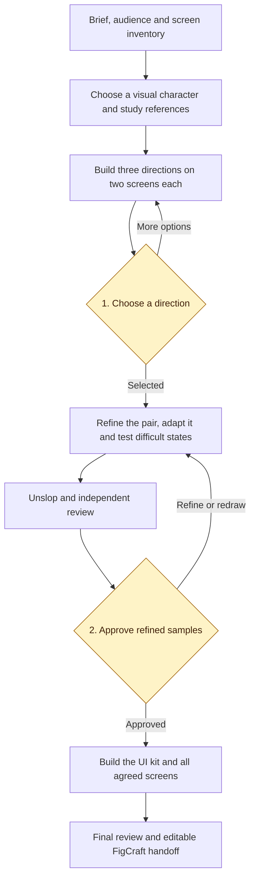

# Design Loop

An agent-led workflow for taking a product idea to editable, reviewed screens and a design system in FigCraft. Works with Codex and Claude Code.

[Quick start](#quick-start) · [Workflow](#how-the-loop-works) · [FigCraft](#figcraft-integration) · [Included skills](#included-skills) · [Project layout](#project-layout)

## Quick start

**1. Install from the target project root.** Use Git and either Node.js 20+ with npm or Bun. Resolve `main` to a commit before invoking the installer so the launcher can cache each revision separately.

```sh
revision=$(git ls-remote https://github.com/ViktorovYaroslav/design-loop.git refs/heads/main | cut -f1)
test -n "$revision" && npx --yes --package="github:ViktorovYaroslav/design-loop#$revision" -- design-loop init
```

For Bun, use the same `revision`:

```sh
test -n "$revision" && bunx --bun --package "github:ViktorovYaroslav/design-loop#$revision" design-loop init
```

<details>
<summary>PowerShell commands</summary>

```powershell
$ref = git ls-remote https://github.com/ViktorovYaroslav/design-loop.git refs/heads/main
if ($LASTEXITCODE -ne 0 -or -not $ref) { throw 'Could not resolve Design Loop main.' }
$revision = ($ref -split '\s+')[0]
$package = "github:ViktorovYaroslav/design-loop#$revision"
npx --yes "--package=$package" -- design-loop init
# Or use Bun
# bunx --bun --package $package design-loop init
```

</details>

| Client | Installer flag | Skill location | Invoke |
| --- | --- | --- | --- |
| Codex | `--agent codex` (default) | `.agents/skills/design-loop/` | `$design-loop` |
| Claude Code | `--agent claude` | `.claude/skills/design-loop/` | `/design-loop` |

Append the flag to `init`. To use both clients, run `init` once for each. Both use the same `design/` directory.

**2. Connect FigCraft MCP** in the client you use for design work. The UI UX Pro Max recommendation script uses Python 3.

**3. Invoke the skill and give it a brief.** Name the workspace when resuming an existing design.

```text
$design-loop Create a new design at design/my-product. My idea: <product, audience, main task>.
```

<details>
<summary>Update or run from a local checkout</summary>

Resolve `main` again with the commands above and replace `init` with `update`. Use the same agent flag you installed with. The `#main` package spec can reuse an older launcher cache, so pass the resolved commit. To install a fixed revision, set `revision` to its full commit SHA. The installer checks the managed skill for local edits before replacing it. Your designs stay in `design/`.

To install from a local checkout, run `node /path/to/design-loop/bin/design-loop.mjs init` from the target project's root. You can also work directly in the Design Loop checkout. Invoke the skill there and use `experiments/<slug>/` as your design workspace.

</details>

## How the loop works



Choose **Restrained**, **Expressive / Fancy**, or **Balanced** before visual research. The designer then builds each screen in focused passes.

**Composition → visual language → content and graphics → components and craft → adaptations and states → motion intent → editorial review**

Before the first checkpoint, the designer compares the full viewport and a task-critical fragment at 100% with relevant references. Component libraries such as MUI X and shadcn/ui inform complex controls and states. [Full workflow](workflow/FLOW.md) · [Progressive construction](workflow/PROGRESSIVE-BUILD.md) · [Reference research](workflow/REFERENCE-RESEARCH.md)

For a full product, the handoff includes an editable UI kit, a page map and coverage of the agreed screen inventory. The designer announces independent reviews and summarizes their findings and fixes. [Independent review](workflow/INDEPENDENT-REVIEW.md) · [Final acceptance](workflow/FINAL-ACCEPTANCE.md)

## FigCraft integration


FigCraft is the interface design and prototyping editor used throughout Design Loop. The agent works in the project's document through FigCraft MCP. It builds editable frames, auto layouts and reusable components, then checks screenshots and inspects the layer tree. The handoff includes the native `.figcraft` file and review exports.

[FigCraft](https://getartcraft.com/apps/figcraft) · [MCP documentation](https://github.com/storytold/figcraft/blob/main/docs/mcp.md) · [App icon credit](https://github.com/storytold/figcraft/blob/5c2a378494df9e8c6dec9da117e9b63d49633fda/assets/app-icon/LICENSE.txt)

## Included skills

`design-loop` is the entry point. It opens these six bundled skills as needed.

| Skill | Role in the workflow |
| --- | --- |
| [Taste](.agents/skills/taste-skill/SKILL.md) | Leads visual research, composition and art direction. |
| [Frontend Design](.agents/skills/frontend-design/SKILL.md) | Critiques whether the design feels specific to the product. |
| [UI UX Pro Max](.agents/skills/ui-ux-pro-max/SKILL.md) | Supports UX and design-system decisions after sample approval. |
| [Emil Design Engineering](.agents/skills/emil-design-eng/SKILL.md) | Refines controls, interaction states and motion intent. |
| [Unslop](.agents/skills/unslop/SKILL.md) | Audits visual hierarchy, repetition, copy and finish. |
| [FigCraft File Craft](.agents/skills/figcraft-file-craft/SKILL.md) | Guides editable layer structure, auto layout and component reuse. |

The package includes the workflow, selected references and required license notices. [Skill roles and source revisions](workflow/SKILLS.md) · [Dependency lock](dependencies.lock.json)

## Project layout

```text
my-project/
├── .agents/skills/design-loop/    # or .claude/skills/design-loop/
│   ├── SKILL.md                  # entry point
│   ├── workflow/                 # method, checkpoints and reviews
│   └── .agents/skills/           # bundled companion skills
└── design/<slug>/
    ├── <name>.figcraft           # editable design
    ├── docs/                     # brief, state and review records
    └── evidence/                 # current exports and verification
```

Design Loop delivers editable FigCraft files, exports and review evidence. Implementation is a separate step. [Final acceptance](workflow/FINAL-ACCEPTANCE.md)

## License

Original Design Loop material is available under the [MIT license](LICENSE). Bundled skills and attributed adaptations retain their own terms. [Third-party notices](THIRD-PARTY-NOTICES.md)
